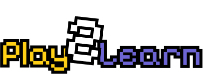

# Play2Learn

Play2Learn turns any topic into a short arcade quiz. You type a topic, pick one of three mini-games, and answer AI-generated questions about that topic by playing the game.



Built at Hack@Brown 2025.

Live demo: https://play2learn-ten.vercel.app/

## Features

- Free-text topic input on the home page, passed to each game as a `topic` query parameter.
- True or False (`app/game1`): pick True or False to move a paddle; a correct answer blocks the ball.
- Multiple Choice (`app/game2`): a highlight cycles through the answer choices every second; press Space or click a choice to shoot the ball at it. Ten questions per round.
- Right or Wrong (`app/game3`): move left and right with the arrow keys and catch the falling missile that carries the right answer. You have three lives and win at 10 points.
- Score tracking and a game-over screen with the final score in every game.

## Tech stack

- Next.js 15 (App Router), React 19, TypeScript
- Tailwind CSS
- axios for API calls
- Question generation: three AWS API Gateway endpoints that call OpenAI (the Lambda code is not in this repo)
- Deployed on Vercel

## Getting started

Prerequisites: Node.js 18 or newer.

```bash
npm install
npm run dev      # http://localhost:3000
```

Other scripts:

```bash
npm run build
npm run start
npm run lint
```

No environment variables are needed. The question endpoints are hardcoded in each game page, so the games only load questions while those endpoints are live. There are no automated tests.

## How it works

`app/page.tsx` is the arcade-themed landing page with the topic input and the three game buttons. Each game page reads the topic from the URL and, on load, POSTs it to its own endpoint on `r9s90fv4id.execute-api.us-east-1.amazonaws.com`:

- `app/game1/page.tsx` calls `/truefalseopenai`
- `app/game2/page.tsx` calls `/multiplechoiceopenai`
- `app/game3/page.tsx` calls `/rightorwrongopenai`

Each endpoint returns a `questions` array with the question text, answer choices, and the correct answer. The rest of the game state (score, animation, lives) is handled client-side with React state. Images for the arcade theme are in `public/`.

## Contributing

Issues and pull requests are welcome. Run `npm run lint` and `npm run build` before opening a PR.

## License

MIT, see [LICENSE](LICENSE).
